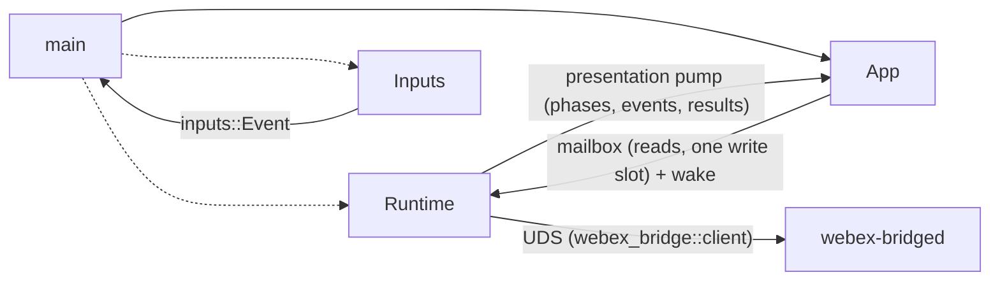

# Tasks

Dotted lines indicate a task or thread spawning another.
Plain lines indicate communication.

`main` runs `bridge::startup` before the terminal UI, spawns the bridge
`Runtime` on its own tokio task and drives the App render loop, which drains
the runtime's events every tick (`app::bridge_glue`). Only the webex-bridge
daemon talks to Webex.
